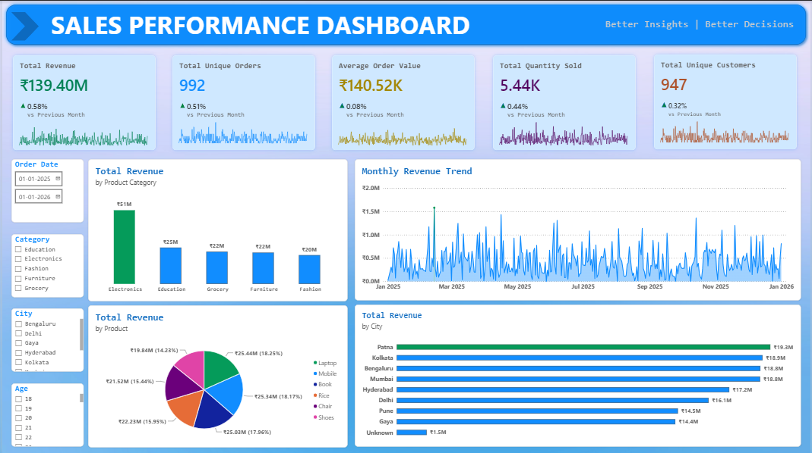

# Sales Performance and Customer Insights

### Deep-Dive Analysis & Interactive Dashboarding | ApexPlanet Internship — Task 3

## 📌 Project Overview

This project focuses on analyzing sales data to understand business performance, identify revenue trends, and generate actionable business insights. An interactive dashboard was developed using Microsoft Power BI to visualize key performance indicators (KPIs) and explore sales performance across product categories, products, cities, and months.

## 🎯 Project Objectives

- Define and analyze key business performance indicators.
- Identify high-revenue product categories and products.
- Compare sales performance across different cities.
- Analyze monthly revenue trends.
- Build an interactive dashboard with KPI cards, charts, and filters.
- Provide data-driven business recommendations.

## 🛠️ Tools and Technologies

- **Python:** Data analysis and exploration
- **Pandas:** Data manipulation and aggregation
- **Matplotlib & Seaborn:** Data visualization
- **Google Colab:** Python analysis environment
- **Microsoft Power BI Desktop:** Interactive dashboard development
- **Microsoft Excel:** Dataset management
- **GitHub:** Project documentation and version control

## 📊 Dataset Overview

The dataset contains 1,000 sales records and 12 columns, including:

- Order ID and order date
- Customer ID, customer name, age, and gender
- City, product, and category
- Quantity, unit price, and total sales

**Analysis period:** January 1, 2025, to January 1, 2026.

## 📈 Key Performance Indicators (KPIs)

| KPI                 |        Value | Business Relevance                        |
| ------------------- | -----------: | ----------------------------------------- |
| Total Revenue       | ₹13.94 crore | Measures overall sales revenue            |
| Total Unique Orders |          992 | Measures distinct order IDs               |
| Average Order Value |   ₹1.41 lakh | Measures average revenue per unique order |
| Total Quantity Sold |        5,435 | Measures total quantity sold              |
| Unique Customers    |          947 | Measures distinct customers               |


## 🔍 Key Business Insights

### 1. Product Category Performance

Electronics is the leading category, generating approximately ₹5.08 crore and contributing around 36.4% of total revenue. Education ranks second at approximately ₹2.50 crore.

### 2. Product Performance

Laptops and mobiles are the highest-revenue products in the displayed results, generating approximately ₹2.54 crore and ₹2.53 crore, respectively.

### 3. City Performance

Patna is the highest-revenue city, generating approximately ₹1.93 crore, followed by Kolkata and Bengaluru.

### 4. Monthly Revenue Trends

Monthly revenue varies throughout the analysis period. January 2026 may represent only a partial month because the latest recorded date is January 1, 2026. Therefore, comparisons involving January 2026 should be interpreted cautiously.

## 📊 Interactive Power BI Dashboard



The dashboard includes:

- KPI cards for revenue, orders, average order value, quantity sold, and unique customers
- Revenue by product category
- Revenue by product
- Revenue by city
- Monthly revenue trend
- Interactive filters for exploring sales data

The dashboard enables users to explore performance across different categories, locations, and time periods.

## 💡 Business Recommendations

1. Monitor inventory and customer demand for high-revenue products such as laptops and mobiles.
2. Investigate the factors contributing to Electronics category performance.
3. Study customer purchasing patterns in high-revenue cities.
4. Monitor monthly revenue trends to identify opportunities and unusual changes.
5. Use interactive dashboard filters to compare performance across business segments.

## 🧹 Data Quality and Limitations

The initial data-quality review identified:

- 20 missing values in the Age column
- 13 missing values in the City column
- Zero exact duplicate rows
- Eight repeated Order ID values

Repeated Order IDs were retained because they may represent multiple records associated with an order. Missing values were reviewed during data preparation.

The analysis is based on the supplied dataset and does not establish the causes behind revenue differences. January 2026 may be incomplete, and the findings should be interpreted accordingly.

## 📁 Project Structure

```text
ApexPlanet-Task-3/
├── data/
│   └── ApexPlanet_DataAnalytics_Dataset.xlsx
├── scripts/
│   └── ApexPlanet_Task_3_Deep_Dive_Analysis.ipynb
├── reports/
│   ├── Deep_Dive_Analysis_Report.md
│   ├── task3_monthly_sales.csv
│   └── task3_kpi_summary.csv
├── dashboard/
│   ├── Sales_Performance_Dashboard.pbix
│   └── Dashboard_Screenshot.png
└── README.md
```

## 📦 Project Deliverables

- Deep-dive sales analysis
- KPI summary CSV
- Monthly sales summary CSV
- Business insights and recommendations report
- Interactive Power BI dashboard
- Dashboard screenshot
- Project documentation

## ✅ Conclusion

This project demonstrates how data analysis and business intelligence tools can be used to evaluate sales performance, identify high-revenue categories and locations, and present insights through an interactive dashboard. The findings can support further investigation and informed business decision-making.

---

**Project:** Sales Performance and Customer Insights  
**Program:** ApexPlanet Data Analytics Internship — Task 3
